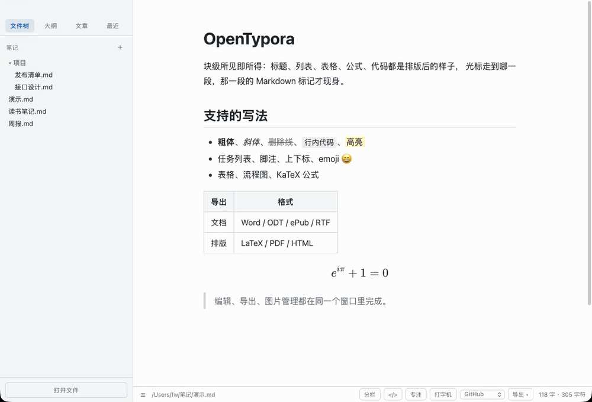
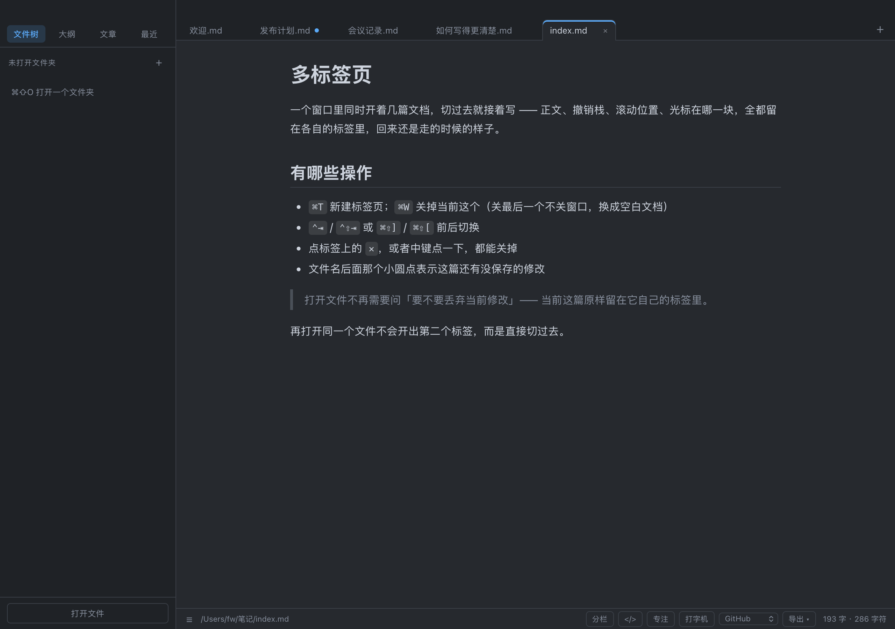
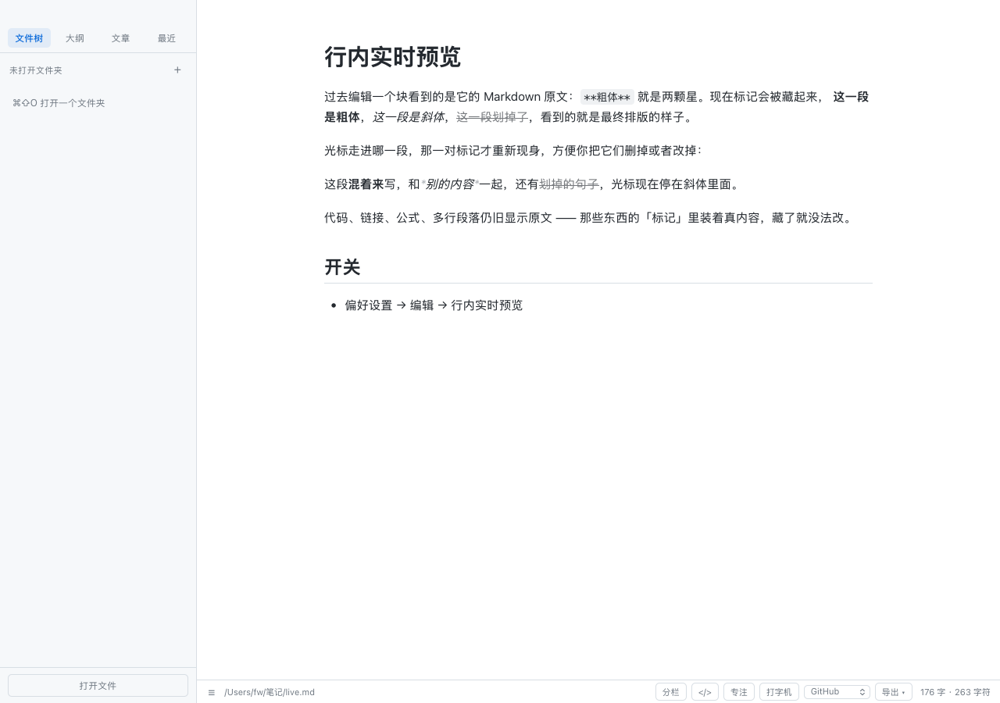
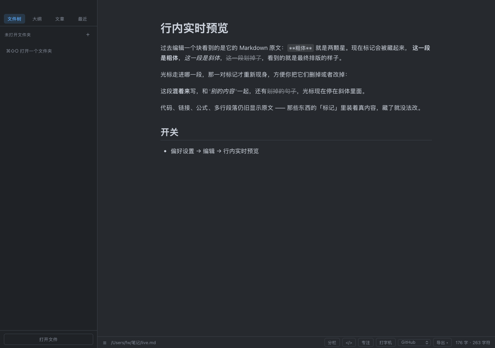

# OpenTypora

[English](README.md) · 简体中文

> macOS 单平台：AppKit + WKWebView 外壳，前端纯 HTML/CSS/JS，不依赖 npm。
> 外部标识：`OpenTypora.app`（可执行文件 `Contents/MacOS/OpenTypora`）、
> bundle id `local.fw.opentypora`、命令行 `opentypora`、用户数据目录
> `~/Library/Application Support/OpenTypora`。
>
> 兼容社区通行的 front matter 键 `typora-copy-images-to` 与 `typora-root-url`
>（决定图片落盘目录与正文引用的相对基准）—— 别的编辑器写的文档拿过来照样认。

从零实现的 Markdown 编辑器：块级所见即所得（WYSIWYG）、分栏「边写边看」、无损序列化、
原生文件读写、多标签页、macOS 本地翻译、KaTeX 公式、Mermaid 图表、工作区搜索、
内置导出（Word / ODT / ePub / LaTeX / RTF / RST / MediaWiki / Textile / OPML / RevealJS /
PDF / 图片 / HTML）与导入（Word / ODT / ePub / HTML / RST / LaTeX）。
AppKit + WKWebView 原生外壳，前端纯 HTML/CSS/JS，唯一第三方依赖是内置的
mermaid.min.js（3.4 MB，按需加载）与 KaTeX 0.19（0.64 MB，含 20 个 woff2 字体），
产物约 5.8 MB。

**不想装也能试**：同一套前端也跑在浏览器里 —— [网页版](https://opentypora-web.app.workbuddy.host/?sharecode=N7ZA4BRQLF)。
`./build-web.sh` 把 `app/` 复制成静态站，并把原生桥接换成
[`web-src/web-shim.js`](web-src/web-shim.js)（用 File System Access / Blob 下载 / `window.print()`
重实现同一组 API）。编辑内核的能力都在：块级编辑、行内实时预览、分栏、主题、KaTeX、Mermaid、导出；
文件夹工作区、本地翻译、系统词典、自定义导出命令需要原生外壳，在网页版里会明确提示而不是假装成功。



> 11 秒动图：`⌘⇧L` 之外的一切都在正文里直接做 —— 打字时 Markdown 标记才现身，
> 光标离开这一段就藏回去；切分栏看源码与预览并排；再换夜间主题。
> 动图由 `test/recdemo.js` 生成演示页、`test/recdemo.swift` 开窗录制、ffmpeg 转 GIF，可复现。

## 安装

支持 macOS 12 及以上（主要在 14 / 15 上验证），仅 Apple Silicon。

应用是 **ad-hoc 签名**——没有 Apple 开发者证书，也没做公证。这意味着系统一定会拦第一次，
和软件本身可不可信无关。下面三种方式都已经把这个处理掉了。

### 方式一：一行命令

```bash
curl -fsSL https://raw.githubusercontent.com/SingleTime/opentypora/main/install.sh | bash
```

下载最新版 → 装进 `/Applications` → 清掉隔离属性 → 直接启动。脚本就是仓库里的
[`install.sh`](install.sh)，执行前可以先读一遍；它只动 `/Applications/OpenTypora.app`
和临时目录。

### 方式二：手动下载

1. 从 [Releases](https://github.com/SingleTime/opentypora/releases) 下 `OpenTypora-*.zip`，
   解压后把 `OpenTypora.app` 拖进 `/Applications`
2. 双击它，会提示「Apple 无法验证…」。点「完成」关掉对话框
3. **一分钟内**打开 **系统设置 → 隐私与安全性**，往下滚到「安全性」区，会看到
   「已阻止使用 OpenTypora」，点旁边的 **仍要打开**，输密码
4. 再双击一次，在确认框里点「打开」

> 第 3 步的按钮只在拦截发生后大约一小时内出现，过期就重新双击一次再去看。

### 方式三：终端里解除隔离

如果你习惯命令行，跳过上面第 2–4 步：

```bash
xattr -dr com.apple.quarantine /Applications/OpenTypora.app
```

> **注意**：macOS 15 起，右键 → 打开这条老办法已经失效了（[Apple 已移除](https://developer.apple.com/news/?id=saqachfa)），
> 只能走系统设置或上面的命令。

想自己编：见[从源码构建](#从源码构建)。

## 截图

| 浅色（多标签页） | 夜间 |
| --- | --- |
|  |  |

| 行内实时预览（标记不在 DOM 里） | 夜间 |
| --- | --- |
|  |  |

## 目录结构

```
opentypora/
├── app/                  前端（会被打进 .app 的 Resources/app）
│   ├── index.html
│   ├── css/app.css       版式 + 6 套主题（GitHub / Night / Newsprint / Pixyll / Whitey / Gothic）
│   ├── vendor/
│   │   ├── mermaid.min.js  内置 Mermaid 11（只在出现 ```mermaid 时才注入加载）
│   │   └── katex/        内置 KaTeX 0.19（js + css + 20 个 woff2，离线渲染公式）
│   └── js/
│       ├── md.js         解析+渲染核心（纯函数，无 DOM 依赖，可 Node 单测；含严格模式开关）
│       ├── inline.js     行内 token 化（导出用：保留公式原文，不套 HTML 再反解；跟随严格模式）
│       ├── emoji.js      `:名字` 补全下拉（打分/触发判定/代码域识别/插入字形）
│       ├── snippet.js    文本片段（解析/序列化/按触发词展开，含 `$0` 光标落点）
│       ├── zip.js        最小 ZIP 写入器（store 模式，零依赖；docx/epub 的底座）
│       ├── docx.js       Markdown → OOXML（标题/表格/脚注/图片/目录域）
│       ├── importer.js   .docx / .html → Markdown（自写标记解析器 + OOXML 语义映射）
│       ├── export.js     ePub 3 + LaTeX + RevealJS 生成器，以及各格式分发（含 HTML 导出选项与导出主题）
│       ├── doc.js        文档级装饰：标题锚点 / [TOC] 目录 / 脚注编号
│       ├── diagram.js    Mermaid 图表：懒加载 / 主题重绘 / 失败降级
│       ├── flow.js       flowchart.js：解析 / 回边剔除 / DAG 分层 / 正交走线 / 出 SVG（零依赖）
│       ├── editor.js     块级编辑引擎（源码态切换/光标映射/撤销栈/自动配对/智能标点）
│       ├── table.js      表格结构编辑（行列手柄/右键菜单/单元格原位编辑/插入对话框/列宽拖拽/拖动排序）
│       ├── fnpop.js      脚注角标悬停预览（浮层复用定义块 DOM）
│       ├── wikilink.js   wiki 链接：`[[` 选单、坏链标记
│       ├── split.js      分栏模式（左源码/右实时预览/同步滚动）
│       ├── workbench.js  工作区（Open Quickly / 全局搜索 / 最近文件 / 文章视图 / 文件树右键 / 草稿）
│       ├── imgman.js     图片管理（插入 / 重命名 / 移动 / 删除 / root-url 路径换算 / 下载远程图）
│       ├── yaml.js       front matter 读取与「导出覆盖」归一化（title/toc/papersize/geometry…）
│       ├── xcmd.js       自定义导出命令：占位符展开 / 程序名提取 / 校验 / 归一化
│       ├── code.js       代码块 Code Tools：自动缩进 / 行注释 / 移行 / Tab 缩进 / 复制为 HTML
│       ├── odt.js        OpenDocument 文本生成（content.xml / styles.xml / Pictures）
│       ├── textfmt.js    RTF / reStructuredText / MediaWiki / Textile / OPML 生成
│       ├── infmt.js      ODT / reStructuredText / LaTeX → Markdown
│       ├── caret.js      光标行的几何：镜像量位置、按行居中、专注模式近邻
│       ├── spell.js      渲染态拼写：切词 / 批量问系统词典 / 波浪线 / 右键建议
│       ├── typography.js 版式三件套：字体预设 / 行距归一化 / 背景色 → CSS 变量表
│       ├── srcmode.js   源码模式的行号 + 高亮层（textarea 透明字 + <pre> 逐行画）
│       ├── tabs.js       多标签页状态机（增删/关闭后激活谁/循环切换/未命名编号/会话序列化，纯函数）
│       ├── live.js       行内实时预览的纯逻辑（能不能 live / 标记区间 / 该露哪几段 / 编辑差分 / 前缀种类）
│       ├── ui.js         侧边栏/大纲/状态栏/标签栏/快捷键/文件操作/导出菜单
│       └── bridge.js     原生桥（无原生环境时优雅降级）
├── native/
│   ├── main.swift        AppKit 壳：窗口/菜单/文件对话框/导出 PDF·图片/打印
│   ├── translate.swift   macOS 本地翻译（Translation.framework，离线）
│   ├── pdfbook.swift     PDF 书签（按标题生成 outline，排除目录页、折行归一）
│   ├── webexport.swift   单页 HTML 的样式注入（app.css 先、自定义主题后）
│   ├── spell.swift       系统词典桥（NSSpellChecker 批量判定 + 建议词，串行后台队列）
│   ├── makeicon.swift    生成应用图标（icns）
│   └── Info.plist
├── bin/opentypora        命令行入口（文件/目录/`-` 读 stdin/`-v`/`-h`）
├── install.sh            从 Release 下载并装进 /Applications（清隔离属性，一行命令安装）
├── install-cli.sh        把 CLI 装进 PATH（默认 /usr/local/bin）
├── test/
│   ├── parser.test.js    121 项解析器单测（node test/parser.test.js）
│   ├── harness.html      23 项引擎集成测试（真实 WebView 运行时）
│   ├── translate.test.js 翻译功能 42 项集成测试（注入 mock 桥，DEMO=1 出演示截图）
│   ├── split.test.js     分栏模式 23 项集成测试（注入 mock 桥，真实 WebView 运行）
│   ├── selbar.test.js    翻译浮标定位 32 项集成测试（分栏/源码/跨行选区坐标）
│   ├── find.test.js      查找替换 33 项集成测试（计数/跳转/替换/撤销/三种视图）
│   ├── prefs.test.js     偏好设置与自定义主题 30 项集成测试
│   ├── doc.test.js       目录/锚点/脚注 46 项集成测试（含样式与分栏一致性）
│   ├── mermaid.test.js   图表 27 项集成测试（渲染/缓存/换主题/坏图降级/分栏/导出）
│   ├── math.test.js      公式 21 项集成测试（displayMode/矩阵/错误降级/字体/分栏/深色）
│   ├── table.test.js     表格编辑 46 项集成测试（增删行列/对齐/菜单/手柄/撤销）
│   ├── table.demo.js     表格编辑演示页（出手柄态与菜单态两张图）
│   ├── math.demo.js      公式演示页（出 docs/opentypora-math.png）
│   ├── image.demo.js     图片尺寸演示页（出 docs/opentypora-image.png）
│   ├── html.test.js      HTML 块 43 项集成测试（判块/渲染/消毒/源码态/分栏/导出）
│   ├── note.test.js      脚注浮层 + wiki 链接 41 项集成测试
│   ├── note.demo.js      笔记链接演示页（出 docs/opentypora-note.png / -pick.png）
│   ├── import.test.js    导入 33 项单测（Word 风格 deflate docx / HTML / 往返 / GBK）
│   ├── epub.test.js      ePub 导入 22 项单测（spine 顺序 / 图片出包 / 脚注 / deflate）
│   ├── reveal.test.js    RevealJS 36 项单测（分页规则 / 目录 / 图片内嵌 / 降级）
│   ├── importweb.test.js 导入 26 项集成测试（WebKit 解压 + UI 入口 + 资源落盘载荷）
│   ├── import.demo.js    导入演示页（出 docs/opentypora-import.png）
│   ├── fixtures.js       导入测试共用的 docx / HTML 样本（deflate 打包）
│   ├── html.demo.js      HTML 块演示页（渲染态与源码态两张图）
│   ├── runall.js         一键全量回归（node test/runall.js）
│   ├── export.test.js    导出引擎 48 项单测（zip/docx/epub/latex + 真实文件校验）
│   ├── exportopts.test.js 导出选项 28 项单测（PDF 纸张/边距夹取、图片格式归一）
│   ├── exportui.test.js  导出菜单与 HTML 选项 106 项集成测试（Bridge 载荷校验）
│   ├── export.demo.js    导出菜单演示页（出 docs/opentypora-export.png）
│   ├── strict.test.js    严格模式/Emoji 补全/Text Snippet/表格拖动/HTML 选项 102 项单测
│   ├── edit2.test.js     同上五项的真实 WebView 集成 53 项测试
│   ├── edit2.demo.js     第六轮演示页（出 docs/opentypora-edit2/-strict/-snippet.png）
│   ├── strictparse.test.js 严格模式解析侧 52 项单测（官方文档每条示例 + 往返无损）
│   ├── flow.test.js      flowchart.js 58 项单测（解析/分层/走线不变量/错误行号）
│   ├── flowdom.test.js   flowchart 真实 WebView 集成 30 项（渲染/换主题/源码态/导出）
│   ├── flow.demo.js      flowchart 演示页（出 docs/opentypora-flow.png）
│   ├── fsundo.test.js    文件操作撤销 31 项单测（内存 FS + 逆操作栈语义/失败路径/上限）
│   ├── fsundodom.test.js 文件操作撤销 41 项集成测试（右键菜单 → toast 撤销按钮）
│   ├── yaml.test.js      front matter 解析与覆盖归一化 84 项单测
│   ├── exportyaml.test.js YAML 覆盖导出 37 项单测（LaTeX/docx/epub/odt/reveal 六出口 + HTML 片段）
│   ├── xcmd.test.js      自定义导出命令 57 项单测（占位符/程序名/校验/归一化）
│   ├── xcmddom.test.js   自定义导出命令 45 项集成测试（偏好编辑 → 菜单 → Bridge 载荷）
│   ├── code.test.js      代码块 Code Tools 110 项单测（缩进/注释/移行/抹平噪声/改写语言）
│   ├── highlight.test.js 语法高亮 135 项单测（32 套词法 / 往返无损 / 别名 / 边角）
│   ├── highlight.demo.js 语法高亮演示页（出 docs/opentypora-highlight.png 与 -night.png）
│   ├── srcmode.test.js   源码模式高亮层 90 项单测（结构/转义/围栏/桩对象 attach）
│   ├── srcmodedom.test.js 源码模式 47 项集成测试（两层文字左起点/行高节奏/滚动同步/sticky 行号）
│   ├── caret.test.js     光标行几何 57 项（行号/区间/居中量/夹边界/近邻/接线/CSS）
│   ├── caredom.test.js   光标行 34 项集成（软换行测量、按行居中、高亮条位置、近邻切换）
│   ├── caret.demo.js     专注 + 打字机演示页（出 docs/opentypora-focus-typewriter*.png）
│   ├── spell.test.js     拼写 126 项（切词/分段/替换定位/接线 + 编译并跑 Swift 真词典断言）
│   ├── spell/main.swift  真词典的 Swift 断言程序（正确词/错拼/ignore/建议词/串行队列）
│   ├── spelldom.test.js  拼写 49 项集成（包 span/跳过代码/偏移命中/右键替换/忽略/开关）
│   ├── spell.demo.js     拼写波浪线与右键建议演示页（出 docs/opentypora-spell*.png）
│   ├── typography.test.js 版式 102 项（预设表/字体清洗/行距夹取/背景归一化/变量表/导出接线）
│   ├── typodom.test.js   版式 59 项集成（真 WKWebView：计算样式、换主题、恢复默认、导出）
│   ├── typo.demo.js      版式演示页（出 docs/opentypora-typography*.png）
│   ├── srcmode.demo.js   源码模式演示页（出 docs/opentypora-source-code.png 与 -night.png）
│   ├── pdfbook.test.js   PDF 书签 51 项（前端 pdfOutline + 编译并跑 Swift 真 PDF 断言）
│   ├── pdfbook/main.swift PDF 书签的 Swift 断言程序（造 PDF → 挂 outline → 读回验）
│   ├── htmltheme.test.js  导出主题 75 项（主题归一化 / 与 app.css 对齐 / 编译并跑 Swift 注入断言）
│   ├── htmltheme/main.swift 样式注入的 Swift 断言程序（位置/顺序/转义/缺 </head> 兜底）
│   ├── htmlthemedom.test.js 导出主题 27 项集成（srcdoc 里量计算样式与滚动）
│   ├── htmltheme.demo.js  导出主题演示页（出 docs/opentypora-html-theme*.png）
│   ├── codemod.test.js   代码块 Code Tools 47 项集成测试（右键菜单 / ⌘/ / Tab / 剪贴板）
│   ├── code.demo.js      代码块 Code Tools 演示页（出 docs/opentypora-code-tools.png）
│   ├── dropfile.test.js  拖文件插链接 33 项单测（路径抠取/三档退化/链接转义）
│   ├── dropdom.test.js   拖文件 / 贴图 27 项集成测试（相对路径/复制进 assets/copy-to 目录/⌥ 打开/源码态）
│   ├── recentdom.test.js 最近文件固定 26 项集成测试（图钉渲染/置顶/落盘/取消/清空）
│   ├── recent.demo.js    最近文件固定演示页（出 docs/opentypora-recent-pin.png）
│   ├── tabs.test.js      标签页状态机 96 项单测（增删/复用/关闭后激活谁/循环/命名/上限/会话序列化）
│   ├── tabsdom.test.js   标签页 92 项集成测试（真 WKWebView：⌘T/⌘W/⌃⇥、现场还原、撤销跨页、会话还原）
│   ├── tabs.demo.js      标签页演示页（出 docs/opentypora-tabs.png 与 -night.png）
│   ├── live.test.js      行内实时预览 87 项单测（能不能 live / 标记区间 / 露出规则 / 差分 / 前缀种类）
│   ├── livedom.test.js   行内实时预览 76 项集成测试（真 WKWebView：藏标记、光标进去现身、打字落回原文、退回 textarea）
│   ├── live.demo.js      行内实时预览演示页（出 docs/opentypora-live.png 与 -night.png）
│   ├── syntax2.test.js   扩展语法 50 项单测（引用式链接/裸 URL/上下标/Emoji/行内 HTML/Callout）
│   ├── workbench.test.js 工作区纯函数 43 项单测（模糊匹配/文章分组/相对路径/时间格式/最近文件固定）
│   ├── cli.test.js       命令行 15 项检查（--help/--version/错误码/语法）
│   ├── bench.js          导出链路性能基准（Node / WKWebView 共用）
│   ├── bench.node.js     基准入口：`node test/bench.node.js`，出各阶段耗时
│   ├── native-smoke.swift 原生翻译链路冒烟测试
│   ├── native-reuse.swift 原生会话复用 / 同语言短路验证（真实翻译）
│   ├── shot.swift        离屏截图工具（自检 UI 用）
│   ├── recdemo.js        生成 README 演示动图的页面（app/__recdemo.html）
│   └── recdemo.swift     开带标题栏的窗口跑演示页，供 screencapture 录制
├── web-src/               浏览器适配层：web-shim.js 用 Web API 重实现 Bridge
├── build.sh              一键构建：图标 → 编译 → 组装 bundle → ad-hoc 签名
├── build-web.sh          生成网页版：app/（去掉测试页）+ web-src/web-shim.js → web/
└── docs/                  spec.md（功能规格与验证记录）+ opentypora-demo.gif +
                           验证截图 + exports/（README 导出的 docx / epub / tex 样例）
```

## 从源码构建

要求：macOS（已在 14/15 上验证）、Xcode Command Line Tools（要 `swiftc`）。没有 npm 依赖，
也不需要 Xcode 工程文件。

```bash
git clone git@github.com:SingleTime/opentypora.git
cd opentypora
./build.sh
cp -R build/OpenTypora.app /Applications/
```

跑测试：

```bash
node test/runall.js          # 57 个套件，3316 项全绿；DOM 套件需要 build/shot
```

## 核心设计

- **块级 WYSIWYG**：文档 = `blocks[{raw}] + gaps[]` 模型。光标进入某块时该块变成
  可编辑面 —— 能走 live preview 的块直接是**渲染态**（`**` 之类的标记不在 DOM 里），
  其余（代码、链接、公式、行内 HTML、表格、多行段落）切成 `<textarea>` 源码态；
  失焦即回渲染态。行内文本片段携带 `data-s` 偏移，点击渲染内容可精确映射回源码光标位置。
- **无损往返**：块间间隔（空行数量）作为 `gaps` 显式保存，`serialize(parse(src)) === src`
  字节级一致，不会偷偷改用户的文件。
- **撤销**：文档级快照栈（300 步，800ms 内连续输入合并），跨块结构操作也可撤销。

## 功能清单

- 标题（ATX/Setext）、粗斜体、删除线、`==高亮==`、行内代码、链接、图片、
  引用（嵌套）、列表（嵌套/有序/任务）、表格、代码围栏（自带高亮器，
  支持 js/ts/py/java/go/rust/sql/bash/json/yaml/css/html）、YAML front matter、水平线
- **扩展语法**（GFM 之外的常用方言）：
  - 引用式链接 `[a][id]` / `[a][]` / `[a]` 与引用式图片 `![a][id]`；`[id]: url "title"`
    定义行作为隐藏块保留在源码里（序列化仍然字节无损），方向键跨块时自动跳过
  - 裸 URL 与 `www.` 自动成链；尾部标点、成对括号、中英文混排都按中文排版边界处理，
    不会把句号或中文标点吃进 `href`
  - 上标 `X^2^`、下标 `H~2~O`、下划线 `<u>`；docx 走 `vertAlign` / `<w:u>`，
    LaTeX 走 `\textsuperscript` / `\textsubscript` / `\underline`
  - 行内 HTML：`<span style>`、`<kbd>`、`<sup>`、`<sub>`、`<mark>`、`<br>` 等
    直接渲染（`on*` 与 `javascript:` 一律剥掉）；只写半截标签时按源码显示，不会吞掉后文
  - Emoji shortcode：内置约 190 条常用映射（`:smile:` `:rocket:` `:+1:` …）
  - Callouts：`> [!NOTE]` / `TIP` / `IMPORTANT` / `WARNING` / `CAUTION`，
    五种配色 + 图标 + 标题行；docx/ePub/LaTeX 导出保留标题
  - 引用块里回车自动续 `> `，空引用行退出
- **代码块**：行号窗（偏好项开关）、33 种语言下拉（只改首行围栏，不动正文，
  认 `js`/`py`/`sh` 这类别名）、一键复制；工具条 hover 才出现，打印与导出图片时自动隐藏。
  **语法高亮覆盖全部 33 个下拉项**（归一成 32 套词法，`shell` 就是 `bash`）：每种语言一张
  方言表，认注释 / 多行字符串 / 数字（含 `10px` 这种带单位）/ 关键字 / 类型 / 属性名 /
  注解 / 预处理指令；`diff` 按增删行着色，`markdown` 认标题与行内标记。
  右键 **Code Tools** 八项：复制代码 / 复制为 HTML（带高亮 span）/ 复制为 Markdown /
  自动缩进整理 / 切换行注释 / 上移行 / 下移行 / 删除块；`⌘/` 切行注释、`⌥↑↓` 移行、
  块内选中多行按 `Tab` / `⇧Tab` 整段缩进。自动缩进不需要真 parser：先把字符串与注释
  抹成等长空格（长度守恒），再按净括号深度重排；Python / YAML 只规范缩进层级不改结构
- **表格**：单元格原位编辑（`<input>` 就地改，Enter 下一行 / Tab 下一列 /
  Esc 取消 / 行末自动补行）、插入表对话框（行数 × 列数）、列宽拖拽（写回分隔行，
  正文字号变化时只放大不缩小）
- **数学公式**：`$行内$` 与 `$$块级$$`（`$$` 独占一行的围栏写法也认），由内置
  KaTeX 0.19 排版 —— 矩阵（pmatrix/bmatrix/vmatrix/array）、多行对齐（aligned/
  align/gather）、分段函数（cases）、求和与积分的上下限（displaystyle）、极限、
  希腊字母、`\text`/`\mathbf` 等全部支持；语法错误显示红字并保留原文，不会把整篇
  渲染打挂。KaTeX 出 MathML + HTML 两份（屏幕阅读器与复制公式可用）
  - 导出：docx/LaTeX 保留 TeX 原文（真公式对象需要 OMML 转换，暂未做）；
    ePub 用内置简化渲染（阅读器不认 KaTeX 依赖 CSS 的排版）；导出单文件 HTML 时
    把 20 个 woff2 以 data URI 内联进 CSS，公式字体不丢
  - Node 侧没有 KaTeX 时自动退回自研 TeX 子集（单测与 ePub 走的就是这条）
- **表格结构编辑**（渲染态，不用切源码）：
  - 鼠标移到任意单元格，左侧浮出「+」插行、顶部浮出「+」插列；右键出完整菜单：
    上/下插行、左/右插列、删除本行/本列、改本列对齐（左/中/右/默认）、删除整张表格
  - 表头行不允许删除；删到最后一列时整张表被移除（走 `Editor.deleteBlock`，不留空块）
  - 改动直接写回 Markdown，并与正文共用同一套撤销栈；新列继承左侧列的对齐
  - 序列化按**东亚宽度**补空格（CJK 算 2 格），所以含中文的表格在源码里也是齐的
  - 单元格里的裸 `|` 会被转义成 `\|`，不会把表格结构写散
- **图片尺寸**：`` 固定宽高、`=300` 只定宽（高按比例）、
  `=x200` 只定高（宽按比例）；路径含空格用尖括号 `<my pic.png>` 包起来；
  `=WxH` 可以和 `"title"` 共存。渲染、docx（EMU 换算）、ePub（`width`/`height`
  属性）、LaTeX（像素 × 0.75 → pt）四处同一套换算，宽度仍受版心封顶
- **HTML 块原样渲染**：`<div>` / `<table>` / `<details>` / `<svg>` / `<style>` 这类整块
  HTML 直接按 HTML 渲染，点一下整块切回源码编辑
  - 判块只认两件事：是不是容器标签、有没有配对闭合 —— `<div>…空行…</div>` 不会被
    空行切成互不相干的三块；找不到闭合就退回「按空行截断」，不会把后文全吞掉
  - `<script>` 与 `onclick` 一类事件属性渲染时剔除（文档不该能操作编辑器自己）
  - 渲染前用浏览器的容错解析器把标签配平一遍，作者漏写 `</div>` 也只影响这一块
  - 导出：HTML 原样带过去；docx / ePub / LaTeX 里只留文字（这几种格式没有 HTML 节点）
- **导入 Word / HTML**（⌘⇧I）：`.docx` 与 `.html` 直接转成本文编辑器能认的 Markdown，
  不需要 pandoc、不联网。内嵌图片会落到 `assets/<文档名>-media/` 并用相对路径引用
  - docx：标题样式、粗斜删、行内代码（字符样式带等宽字体也认）、有序/无序/嵌套列表
    （读 `numbering.xml` 的真编号）、引用、代码块、表格（对齐 + `gridSpan` 合并补空）、
    超链接（走 `document.xml.rels`）、内嵌图片（按 `wp:extent` 换算像素）、真脚注
  - html：标题/段落/列表/引用/代码块/表格/图片（`width`/`height` 直接变 `=WxH`），
    `<br>` 变硬换行；`<svg>`、`<details>` 这类 md 表达不了的整块元素原样保留成 HTML 块
  - 判据是**语义**不是外观：Word 的 `Quote` 样式出引用（不再重复包一层斜体）、
    「空段落 + 下边框」出分隔线、字符样式带 Consolas/Menlo 的 run 才当行内代码
- **目录 / 锚点 / 脚注**：
  - `[TOC]` 独占一行即渲染成整篇目录，按标题层级自动嵌套；标题改名、增删、
    换文件时目录自己跟着变，导出 HTML / PDF 里也是填好的
  - 每个标题自动获得 GitHub 风格锚点 id（中文原样保留、标点去掉、空白转 `-`，
    同名自动加 `-1`/`-2`），`[去第二章](#第二章-安装)` 这类内链点一下就滚到目标
    并高亮闪一下，分栏预览里同样可用（在预览容器内部滚动，不会让 WebView 跳走）
  - 脚注 `[^id]` + `[^id]: 正文`：角标按**出现顺序**自动编号（与作者写的标号无关），
    点击滚到定义；定义块支持续行与行内格式
  - **脚注悬停预览**：鼠标停在角标上 90ms 后浮出定义正文（带粗体、行内代码、链接的
    真实排版，不是 `title` 的工具提示），鼠标移开或页面一滚就收起；浮层靠近边缘时
    自动翻到角标下方并夹在视口内
- **wiki 链接**：`[[笔记名]]` 跳到另一篇笔记，`[[笔记名|显示文字]]` 换显示名，
  `[[#小节]]` 跳本文标题
  - 敲到 `[[` 就浮出笔记选单（当前文件夹里的 `.md`，子目录用相对路径区分同名），
    ↑↓ 选、Enter/Tab 插入、Esc 关掉；没匹配时空格与回车都不拦，回车照常拆块
  - 目标按「当前文档目录 → 文件夹根 → 文件树按名字找」三级解析，所以文件挪到
    子目录里也还能点开；都找不到才提示
  - 文件树能判断时，目标不存在的链接显示成灰色虚线（`.wiki-missing`），点一下给提示
  - 导出：HTML 保留；docx / ePub / LaTeX 只留显示文字（目标 `.md` 不在包里，
    留着会变成死链接）
- **版式可调**：正文字体（系统默认 / 苹方 / 宋体 / 楷体 / 仿宋 / 圆体 / 等宽 + 自定义字体族，
  只列本机真有字形的）、行距（1.3–2.4，正文与标题同比缩放，代码块不参与以保住行号对齐）、
  背景色（可「跟随主题」一键还原）；三项都实时生效、落偏好，导出的单页 HTML 带同一组变量
- **行内实时预览**（偏好「编辑 → 行内实时预览」，默认开）：编辑一个块时看到的是排版结果，
  `**粗体**` 的两颗星不出现、字本身就是粗的；光标走进哪一段强调，那一对标记才现身，
  方便删改。标题的 `## ` 也藏，光标落到行首才露出来，退格一次去掉整个前缀、标题变回正文。
  原文仍是唯一真源：DOM 里改的每个字按「文本前后最小差异」翻回 `raw` 再重画，
  `serialize(parse(src)) === src` 不变；撤销 / 自动配对 / 智能标点 / 表情补全 / `⌘B` 这些
  一律照旧（编辑面装了一套与 textarea 同名的 `.value` / `.selectionStart` 接口）。
  **代码、行内代码、链接、公式、行内 HTML、表格、任务框、多行段落**这类「标记里装着真内容」
  或结构复杂的块自动退回源码态 —— 藏了反而没法改
- 主题 ×6（GitHub / Night / Newsprint / Pixyll / Whitey / Gothic）、
  **专注模式**（光标块 100% / 前后各一块 62% / 其余 30%，光标行再垫一条淡强调色底）、
  **打字机模式**（按「光标行」居中，多行块里折行也准）、
  **源码模式（⌘/）带行号与语法高亮**（围栏内按语言上色）、分栏模式（⌘⇧L）、
  **跟随系统外观**（系统切深色自动换 Night）
- **拼写检查**：块内 textarea 走 WebKit 原生检查；渲染态由 `spell.js` 切词后批量问
  系统词典（`NSSpellChecker`，与 textarea 同一个检查器），命中词画红波浪线，
  右键给建议词与「忽略此词」（忽略表落偏好）；代码块/行内代码/公式/Mermaid 不参与，
  判过的词进缓存并落 `localStorage`，重画不再问原生
- **写作手感**：自动配对（括号/引号/Markdown 符号，偏好项可关）、智能标点
  （`--`→`–`、`---`→`—`、`...`→`…`、成对直角引号）、视图缩放（⌘+ / ⌘- / ⌘0，
  只放大正文区）、字数面板（字/字符/行/段落/阅读时间/选区，点状态栏展开）、
  复制为 Markdown（⌘⇧C）、粘贴为纯文本（⌘⇧V）、选词 ⌘D / 选行 ⌘L
- **工作区**（打开文件夹后）：
  - 文件树右键：新建文件/文件夹、重命名、复制副本、移到废纸篓、在 Finder 中显示
  - Open Quickly（⌘⇧O）：模糊子序列匹配，连续与词首加分，↑↓ 选、Enter 开
  - 全局搜索（⌘⇧F）：逐文件异步扫，命中显示行号与行文本，点结果直接跳到该位置；
    支持大小写/全词/正则
  - 「文章」视图：按修改时间/名称/大小排序，可平铺或按文件夹分组
  - 「最近」视图：最近打开的 30 篇（localStorage）；行尾图钉可「固定到列表」，
    固定项按固定时间倒序置顶且不会被新记录挤掉（超 30 只淘汰未固定项）
  - 目录变动自动刷新（4 秒轮询比对签名）、未保存草稿定时落盘并在启动时询问恢复
  - 标准 `.md` 相对链接（`./a.md`、`../x/y.md`、`#锚点`）在应用内打开；
    目标不存在时问一句「要新建吗」
- **多标签页**：一篇文档一个标签，标签栏只在开了两个以上时才出现（单文档时零占位）。
  `⌘T` 新建、`⌘W` 关当前（关最后一个换成空白页而不是关窗口，关窗口是 `⌘⇧W`）、
  `⌃⇥` / `⌃⇧⇥` 与 `⌘⇧]` / `⌘⇧[` 前后切换、中键关闭、`⌘⇧T` 重开刚关掉的那篇。
  - 切走时把**整块现场**存进标签：正文、路径、脏标记、滚到哪、光标在哪个块的第几个字符、
    撤销/重做栈 —— 切回来连 ⌘Z 都能接着按，不是重新加载一遍。
  - 同一个文件不会开两个标签，再打开就切过去（避免覆盖别处没保存的修改）。
  - 有未保存改动才问「要保存吗」，干净标签直接关。
  - 标签上的圆点表示未保存，鼠标移上去让位给关闭按钮；自动保存一次就灭。
  - 上限 24 个，超了提示而不是静默丢弃。
  - **重启后整排标签还在**：只记路径，正文一律以磁盘为准（没保存的改动不该跨重启活着，
    那种情况归「未保存草稿」那条路）；文件被删/挪走的跳过并提示一次；命令行或双击
    打开某篇时以那篇为准，不恢复会话。
- 大纲导航（顶部筛选框 + 标题折叠）、自动保存、粘贴/拖图落盘（默认 `assets/`，front
  matter 写了 `typora-copy-images-to` 就跟着那个目录走；一次拖多张全部插入）
- **拖文件插入链接**：从 Finder 拖非图片文件进来，就在光标处插一条 Markdown 链接 ——
  能拿到绝对路径（`text/uri-list` / `text/plain`）就算相对当前文件的路径，只链文件名；
  拿不到路径但读得到内容（HTML5 File）就复制进 `assets/` 再链；两样都不行就只链文件名并提示。
  空格转 `%20`、圆括号转 `%28%29`。按住 `⌥` 拖 `.md` / `.txt` 仍是直接打开
- **文件操作撤销**：新建 / 重命名 / 副本 / 移到废纸篓 / 移动到… 五类操作都能撤销 ——
  操作完 toast 上挂「撤销」按钮（5 秒），文件菜单「撤销文件操作」同样有效；
  逆操作栈上限 20 步。废纸篓靠原生 `trashItem(resultingItemURL:)` 拿到真实落点再搬回
- **图片管理**（图片右键）：重命名（改磁盘名并同步改引用）、移动到/复制到文件夹、
  删除（文件进废纸篓 + 引用移除）、复制路径/Markdown、**下载到本地**（`http(s)` 图抓进
  `assets/` 并改写引用）；`⌘⌃I` 从磁盘插入本地图片；「编辑 → 整理全部图片到 assets」
  批量搬、「下载全部远程图片」一次抓完；front matter 支持 `typora-copy-images-to`
  与 `typora-root-url` —— **`⌘⌃I`、粘贴、拖入三种入口走同一套路径解析**；偏好里可开图片居中
- **Emoji 补全**：块内敲 `:名字` 弹出候选（↑↓/Enter/Tab 选、Esc 关），插入的是字形本身；
  打分按「前缀 > 词段 > 中间」，同分看名字长短；`12:30`、`http://`、`a::b` 不会误触发，
  行内代码与围栏块里不弹
- **文本片段（Text Snippet）**：偏好里一行一条 `触发词 => 内容`，支持 `\n`/`\t`/`\\`
  转义与 `$0` 光标落点；在编辑器里敲触发词按 Tab 展开，中文触发词同样有效
- **严格模式**：视图菜单或偏好开关，渲染侧与**解析侧**同时生效。
  - 渲染侧：关掉高亮、上下标、Emoji、笔记链接、Callout 这些扩展语法，源码一个字符不动；
    导出器吃同一套 tokenize，不会出现「预览里是字面 `==x==`、Word 里变成高亮」的不一致
  - 解析侧：`###Header` 不再算标题（严格档要求 `#` 后有空白），列表续行与子列表必须
    缩进对齐到内容列（`indent + 标记宽 + 1`）；切档会 `reparse()` 重建块模型，
    两档都保持 `serialize(parse(src)) === src` 无损
- **表格行列拖动排序**：按住行/列手柄拖到目标处，落在上半插在前面、下半插在后面，
  拖动时有指示线；表头行不参与拖动；拖完不会误触发「插入一行」
- 导出 HTML（可选主题 / 可去样式 / 可内嵌图片 / 可限宽）/ PDF（纸张·边距·页眉页脚·H1 分页·书签）/
  图片（PNG·JPEG 整页长图）/ Word / ODT / ePub / LaTeX / RTF / RST / MediaWiki /
  Textile / OPML / RevealJS，详见下节
- **原生打印**（⌘P，带系统打印面板）
- **命令行**：`opentypora file.md`、`opentypora 目录`、`echo '# hi' | opentypora -`、
  `opentypora -v`，见下节
- **查找 / 替换**（⌘F / ⌘⌥F）：全文按字符偏移匹配，渲染态直接落到块内选区，
  源码态与分栏态落到 textarea 原生选区；支持区分大小写、正则、上下跳转、
  替换当前 / 全部替换，替换与撤销都在同一套快照栈里
- **偏好设置**（⌘,）：正文字号、正文宽度、自动保存、拼写检查、严格模式、文本片段、
  **自定义导出命令**（名称 / 命令 / 扩展名，上限 12 条，可一键填入 pandoc 预设），
  主题下拉里自动列出用户主题；设置存在 localStorage，重启恢复
- **自定义主题**：把 `*.css` 丢进 `~/Library/Application Support/OpenTypora/themes`，
  重新扫描后出现在主题列表；`CSS 里的 :root / html 会被自动抬权到 html[data-theme]`，
  因此 `:root { --bg: …; --text: … }` 就能覆盖内置配色，切换回内置主题时自动清空
- **分栏模式**：左栏 Markdown 源码（软换行可关、关后显示行号），右栏实时预览
  （输入防抖 90ms）。滚动任一侧另一侧按比例跟随（可关）；点预览块光标跳到
  左侧对应位置；中缝可拖动改比例；比例/开关/是否启用都记忆在 localStorage，
  重启恢复。分栏里的编辑直接进文档模型：字数、大纲、自动保存、导出全部同步，
  翻译浮标与 ⌘B/⌘I/⌘K/⌘1-6 快捷键照常可用。
- **本地翻译**：选中文本 → 浮动「译」按钮或 ⌘⇧Y → 调用 macOS Translation.framework
  在设备上翻译（不出网）。默认译为中文（简体），面板里可切换 12 种目标语言并记忆。
  译文可复制 / 插入下方 / 精确替换原文（渲染态基于 `data-s` 偏移映射回源码偏移）。
  - **不会再问你“翻成什么语言”**：源语言由本地按文字体系判定（假名→日、谚文→韩、
    汉字→简中、西里尔→俄、阿拉伯→阿…拉丁字母→英）并显式传给系统。系统只在识别
    不出源语言时才弹语言选择框，把源语言钉死就没有这个交互了。
  - 源语言 = 目标语言时直接短路，不惊动系统，并给一个「改译为 English」的一键入口。
  - 同一语言对**复用常驻会话**（空闲 2 分钟才释放），第二次起不再重建会话、不再重新
    准备语言。实测第二次翻译 0.08 秒。
  - 首次使用某种语言仍需系统下载语言包（一次性，之后完全离线）。

### Mermaid 图表

写一个 ```` ```mermaid ```` 代码块，渲染出来就是图；点进块里还是原来的源码。

- **懒加载**：3.4 MB 的 mermaid 只在文档里真的出现图表块时才注入，纯文字文档零成本。
- **不替换源码节点**：渲染是把 `<svg>` 插到块里、给块加 `.mermaid-on` 让 `<pre>` 隐藏，
  源码文本节点仍然在，`data-s` 字符偏移不断，点击定位与选区翻译照常工作。
- **按「主题 + 源码」缓存**：编辑器每敲一个字都会重渲染块 DOM，缓存命中时同步贴 SVG，不闪。
- **换主题重画**：mermaid 的配色在 initialize 时定死，切主题/换自定义 CSS 会整篇重画。
- 支持 flowchart / sequence / class / state / gantt / pie 等 Mermaid 11 全部图型。
- **语法错误不炸**：坏图标红提示（带 mermaid 的原始报错），源码保持可见，其它块照常渲染。
- 导出 HTML / PDF 里是内联 SVG，不依赖外部资源。

### flowchart.js

```` ```flow ```` 代码块走内置的 `flow.js`（约 420 行，零依赖，不需要 3.4 MB 的 mermaid）：

```
st=>start: 开始
op=>operation: 处理数据
cond=>condition: 通过?
e=>end: 结束

st->op->cond
cond(yes)->e
cond(no)->op
```

- **节点**：`id=>type: 文字`，type 有 start / end / operation / condition / inputoutput /
  subroutine 六种（对应圆角矩形 / 圆角矩形 / 矩形 / 菱形 / 平行四边形 / 双竖线矩形）。
- **边**：`a->b`、链式 `a->b->c`、带标签 `a(是)->b` 或 `a->|是|->b`；标签里 `\n` 换行。
- **分层**：DFS 标记回边，在剔除回边后的 DAG 上松弛分层（不然环会把层号抬爆）；
  层内按声明顺序排，回边走画布外侧通道绕行。
- **走线**：横向段只走层间间隙、纵向段只走画布外通道，不穿过任何节点（有单测守着）。
- **出错不炸**：语法错误报行号、源码保持可见，其余块照常渲染。
- ePub / RevealJS 导出时 SVG 会被内嵌进去（`export.js` `inlineFlow`），不依赖外部资源。

### 导出（HTML / PDF / 图片 / Word / ODT / ePub / LaTeX / RTF / RST / Wiki / Textile / OPML / RevealJS）

状态栏右下「导出 ▾」向上弹出十七项（五组），配了自定义命令会再多一组；
菜单栏「文件 → 导出」里同一套，另有快捷键。

| 格式 | 快捷键 | 产出 |
| --- | --- | --- |
| HTML | ⌘⇧E | 单文件网页，样式与公式字体（data URI）内联 |
| HTML（无样式） | — | 只有语义结构，不带 `app.css`；包裹层限宽是独立选项 |
| HTML 选项… | — | 对话框：带/不带样式、图片内嵌 data URI、正文限宽 830px、自定义 `<head>` / `</body>` 前片段（原样插入不转义）；选择记忆进偏好 |
| PDF | ⌘P（原生打印面板） / ⌘⇧P（直接导文件） | 纸张 A4·Letter·A3·A5、边距 pt、页眉页脚、H1 另起一页 |
| 图片 | — | PNG / JPEG 整页长图（临时撑高 WebView 截图后还原） |
| Word | ⌥⌘W | `.docx`：Heading 1-6 样式、表格（继承分隔行的对齐）、**真脚注**、内嵌图片 |
| ePub | ⌥⌘B | `.epub`：真 `h1..h6`、`nav.xhtml` 嵌套目录、脚注锚点+回链、图片入 `OEBPS/images/` |
| LaTeX | ⌥⌘X | `.tex`：`ctexart`，XeLaTeX 直接编译；公式保留原文 |
| OpenDocument | ⌥⌘D | `.odt`：`text:h` 大纲、`text:list`、`table:table`、**原生脚注**、图片进 `Pictures/` |
| RTF | — | `.rtf`：`\uNNNN?` 转义、粗斜体/删除线、`\trowd` 真表格、超链接域，Word 直接打开 |
| reStructuredText | — | `.rst`：下划线标题、`code-block` 指令、grid 表、脚注、`image` 指令（Sphinx 可用） |
| MediaWiki | — | `.wiki`：`= 标题 =`、wikitable、`<syntaxhighlight>`、`<ref>` |
| Textile | — | `.textile`：`h1(#id).` 块签名、`*粗*`/`_斜_`/`@码@`、`"文字":url`、`\|_.` 表头、`bc.` 代码、`fn1.` 脚注 |
| OPML | — | `.opml`：按标题成树，正文进 `_note`，可导进思维导图 |
| RevealJS | — | `.html`：单文件幻灯片，h1 横向 / h2 纵向分页，图片内嵌 data URI；离线打开自动降级成滚动文档 |
| 自定义命令 | — | 见下节 |

PDF 选项存在偏好里，「PDF 选项…」改过之后直接点 PDF 就沿用上次的纸张与边距；
H1 分页是在主线程先给 `body` 挂 `pdf-h1page` 再打印，避免原生侧异步注入赶不上排版。

#### YAML front matter 覆盖导出设置

文档开头的 front matter 会覆盖导出设置，优先级高于偏好与文件名：

```yaml
---
title: 年度报告
subtitle: 2026 财年
author: FW
date: 2026-10-18
keywords: 年报, 财务
toc: true
toc-title: 目次
papersize: a4
geometry: margin=2cm,top=3cm
fontsize: 12pt
linestretch: 1.5
documentclass: ctexbook
---
```

- `title/subtitle/author/date/keywords` → LaTeX preamble、docx / odt / epub 元数据、HTML `<meta>`、PDF 纸张
- `toc: true` → LaTeX `\tableofcontents`、docx TOC 域（正文已有 `[TOC]` 时不重复插）
- `papersize` → 覆盖 PDF 偏好里的纸张；`geometry/fontsize/linestretch/documentclass` → LaTeX 模板
- 会原样进 preamble 的字段（`geometry` / `linestretch` / `documentclass`）过白名单与字符黑名单，挡注入

#### 自定义导出命令（pandoc 等）

内置导出器覆盖不到的格式，可以在「偏好设置 → 自定义导出命令」里挂外部命令，
配好之后出现在导出菜单最后一组：

```
pandoc -f markdown -t icml --resource-path="{dir}" "{src}" -o "{out}"
```

| 占位符 | 含义 |
| --- | --- |
| `{src}` / `{currentFilePath}` | 当前文档的临时 `.md` 副本 |
| `{out}` / `{outputPath}` | 保存面板选定的输出文件 |
| `{name}` | 文档主名（不含扩展名） |
| `{dir}` | 文档所在目录（用来找相对路径的图片） |
| `{ext}` | 这条命令声明的输出扩展名 |

- 命令交给 `/bin/sh -c` 执行，`{out}` 是硬要求（缺了不让保存）；`sudo`、`rm`、`$()` 一类会给警告
- 「填入 pandoc 预设」一键加 ICML / DocBook 5 / AsciiDoc 三条（需要先 `brew install pandoc`）
- pandoc 没装时提示 `brew install pandoc`，而不是丢一句 `command not found`
- 输出重定向到文件而不是 Pipe：命令打印再多也不会卡住（实测两万行无阻塞）

为什么内置格式不用 pandoc：pandoc 的 arm64 单文件解压后约 120 MB，而这里 docx / odt / epub 本质上
就是 zip 包 —— 自己写一个 store 模式 ZIP 写入器（`zip.js`，约 100 行）+ 一套
WordprocessingML / OPC 生成（`docx.js`）+ OpenDocument 生成（`odt.js`），
RTF / RST / MediaWiki / OPML 则直接是文本生成（`textfmt.js`），
内置导出链路零外部依赖、离线可用；pandoc 只作为「要更多格式」时的可选外挂。

实现要点：

- **ZIP 不压缩（store）**：Word 与 iBooks 都认。省掉 DEFLATE 实现，代价只是体积大 20~30%；
  epub 的 `mimetype` 必须是第一个条目且不压缩、无 extra field —— store 模式天然满足。
- **行内 token 化**（`inline.js`）：docx/LaTeX 需要的是结构化 run，把 HTML 反解会丢掉
  `$E=mc^2$` 的原文（md.js 渲染时已经转成了 HTML span），所以按同一套规则重新 token 化一次。
- **脚注是真脚注**：`w:footnote` + `word/footnotes.xml`，编号按**正文首次引用顺序**
  （与作者定义顺序无关）；ePub 里换成 `#fn1` 锚点 + `↩` 回链。
- **`[TOC]` 不糊弄**：docx 写的是 TOC 域（Word 里右键「更新域」就出页码），ePub 写的是
  真正的嵌套 `<ol>` 目录，与 `nav.xhtml` 一致。
- **图片按真实像素内嵌**：从 PNG IHDR / JPEG SOF / GIF / BMP 头里读宽高，换算 EMU 并
  按 A4 正文宽度封顶；读不到的文件（远程图片、缺失文件）退化为 `[图片：alt]` 并给警告，
  不会留破图。
- **样式自带**：`styles.xml` 里定义 Normal / Heading1-6（带 `outlineLvl`，Word 目录域才认）/
  Quote / CodeBlock / ListParagraph / FootnoteText / Hyperlink / TableGrid，
  中文字体 PingFang SC、等宽 Menlo。
- 导出时会先把归档写进 base64 交给原生侧落盘（`exportFile`），图片则通过 `readBinary`
  按当前文档目录解析相对路径。

### 导入（Word / ODT / ePub / HTML / RST / LaTeX → Markdown）

菜单栏「文件 → 导入（Word / ODT / ePub / HTML / RST / LaTeX）…」（⌘⇧I）。全程本地转换，不发任何网络请求。

- `.docx`：解 zip 读 `document.xml`，按 WordprocessingML 语义还原（脚注、表格、图片出包）
- `.odt`：解 zip 读 `content.xml`，`text:h` / `text:list` / `table:table` / `text:note` 逐块还原，
  `Pictures/` 里的图片取出来落到 `assets/<文档名>-media/`
- `.epub`：解 zip 读 `META-INF/container.xml` → OPF，按 `spine` 顺序逐章转（跳过 `nav` 与
  `linear="no"`），包内图片按章节相对路径解出去重后落到 `assets/`，文末脚注区还原成 `[^n]:`
- `.html` / `.htm`：DOM 走一遍，容器块展开、行内收敛成 Markdown
- `.rst`：行扫描 —— 下划线标题、指令块、grid 表格、`[#x]_` 脚注、缩进引用
- `.tex` / `.latex`：去注释、取 `\begin{document}` 内文；`\section` 系列按 article/book 定级，
  `itemize`/`enumerate`/`description`、`tabular`、`verbatim`、`equation` 环境逐个还原，
  行内 `\textbf`/`\emph`/`\texttt`/`\href`/`\footnote`/`\includegraphics[width=…]` 转成对应语法

流程：选源文件 → 前端转换 → **有内嵌图片时先问 `.md` 存哪儿**（图片总得落地）→
一次性写盘 → 打开。纯文本（没有图片）直接开成未命名文档，⌘S 再决定放哪儿。

实现要点：

- **自写标记解析器**：HTML 与 OOXML 共用一套 tokenizer + 树构建。XML 模式关掉 HTML 的
  void 元素与隐式闭合（`<w:p>` 里那个 `p` 不是段落），HTML 模式关掉大小写敏感与自闭合怪癖。
  好处是同一套判块逻辑能直接复用，坏处是没有浏览器的容错能力 —— 所以解析器对
  「标签没闭合」「属性没引号」都做了兜底，不会因为一处畸形就丢整篇。
- **docx 解压**：真 Word 文件是 deflate（method 8），而 `zip.js` 只写 store（导出侧的取舍），
  所以读入时用 `DecompressionStream('deflate-raw')` 解压（macOS 13+ 与 Node 18+ 都有），
  store 条目直接取字节。
- **判据是语义不是外观**：Word 的 `Quote` 段落样式出 `>`（不再重复包一层斜体）；
  「空段落 + 下边框」出 `---`；带 `numPr` 的段落去 `numbering.xml` 查真编号（bullet / decimal /
  startOverride），连续同类项合成紧凑列表；只有字符样式解析出等宽字体时才当行内代码。
- **不猜**：认不出的结构（域代码、批注、修订删除、SmartArt、嵌套表格）直接跳过 —— 宁可少一行，
  也不产出半截语法。
- **md 表达不了的样式**：下划线/高亮只留文字；上标下标能整体映射成 Unicode（`m²`、`H₂O`）就映射，
  有一个字符映射不了就整段退回普通文字；`<svg>`、`<details>` 这类整块元素原样保留成 HTML 块
  （编辑器本来就渲染 HTML 块）。
- **往返自洽**：`md → docx（本项目导出）→ md` 保留标题/列表/引用/表格/分隔线/行内代码，
  单测里就是拿自己导出的 docx 回头验的。

## 快捷键

| 操作 | 快捷键 |
| --- | --- |
| 新建 / 打开 / 打开文件夹 | ⌘N / ⌘O / ⌘⌥⇧O |
| 新建标签页 / 关闭标签页 | ⌘T / ⌘W |
| 上一个 / 下一个标签页 | ⌃⇧⇥ / ⌃⇥（或 ⌘⇧[ / ⌘⇧]） |
| 关闭窗口 | ⌘⇧W |
| Open Quickly / 全局搜索 | ⌘⇧O / ⌘⇧F |
| 新窗口 | ⌘⇧N |
| 保存 / 另存为 | ⌘S / ⌘⇧S |
| 源码模式 / 分栏模式 / 侧边栏 | ⌘/ / ⌘⇧L / ⌘\ |
| 标题级别 1–6 / 正文 | ⌘1…⌘6 / ⌘0 |
| 粗体 / 斜体 / 行内代码 / 链接 | ⌘B / ⌘I / ⌘E / ⌘K |
| 删除线 / 高亮 | ⌘⇧X / ⌘⇧H |
| 插入本地图片（多选） | ⌘⌃I |
| 查找 / 查找并替换 | ⌘F / ⌘H |
| 缩放 +/−/原始 | ⌘+ / ⌘- / ⌘0 |
| 复制为 Markdown / 粘贴为纯文本 | ⌘⇧C / ⌘⇧V |
| 选中单词 / 选中当前行 | ⌘D / ⌘L |
| 插入表格对话框 | ⌘⌥T |
| Emoji 补全（块内 `:名字`） | ↑↓ 选择 / Enter 或 Tab 插入 / Esc 关 |
| 文本片段展开（块内敲触发词） | Tab |
| 表格行/列拖动排序 | 按住行/列手柄拖到目标处 |
| 严格模式 | 视图 → 严格模式（偏好里也有开关） |
| 行内实时预览 | 偏好「编辑 → 行内实时预览」；光标进到某段强调里，那对标记才现身 |
| 偏好设置 | ⌘, |
| 翻译选中内容 | ⌘⇧Y |
| 导入 Word / HTML | ⌘⇧I |
| 打印 / 导出 PDF | ⌘P / ⌘⇧P |
| 导出 HTML | ⌘⇧E |
| 导出 Word / ODT / ePub / LaTeX | ⌥⌘W / ⌥⌘D / ⌥⌘B / ⌥⌘X |
| 重新打开已关闭的文件 | ⌘⇧T |
| 撤销 / 重做 | ⌘Z / ⇧⌘Z |

## 命令行

```bash
./build.sh && sudo ./install-cli.sh     # 装到 /usr/local/bin/opentypora

opentypora note.md          # 打开文件（多个参数各开一个实例）
opentypora ~/notes          # 把目录作为工作区打开
echo '# hi' | opentypora -  # 从 stdin 读 Markdown，落成临时文件后打开
opentypora -v               # 版本（读 Info.plist）
```

脚本只是 `open -a` 的薄包装（`OPENTYPORA_APP` 可覆盖 app 路径），`test/cli.test.js`
覆盖 `--help` / `--version` / 未知选项退出码 / 文件不存在提示。

## 已验证

一条命令跑全部（纯 Node 套件直接跑，harness 套件自动交给 `build/shot` 取 `__report`）：

```bash
node test/runall.js            # 合计 3316/3316（57 个套件）
node test/runall.js table math # 只跑指定套件
```

- `node test/parser.test.js` → 解析/序列化 121/121（含公式 6 条、图片尺寸 8 条、
  HTML 块 14 条、wiki 链接 9 条，每条都验「解析 → 序列化」字节无损）
- `node test/syntax2.test.js` → 扩展语法 50/50（引用式链接/图片、裸 URL 边界、
  上下标、Emoji、行内 HTML 与消毒、Callouts、三条导出链的 token 一致性）
- `node test/workbench.test.js` → 工作区纯函数 43/43（模糊匹配加分、文章分组与排序、
  相对路径解析、最近时间文案、最近文件的固定/置顶/上限淘汰）
- `node test/odt.test.js` → ODT 53/53（zip 条目顺序与 mimetype、`text:h` 大纲级别、
  `text:list` 编号/嵌套、`table:table` 列数与表头样式、`text:note` 脚注序号、
  图片进 `Pictures/` 且按 96dpi 折 cm、超宽封顶 15cm、PNG/JPEG/GIF 尺寸解析、
  缺图时文字占位 + 警告）
- `node test/textfmt.test.js` → 文本系导出 112/112（RTF 的 `\u` 转义与负数代理项、
  表格 `\trowd/\cellx`、HYPERLINK 域；RST 的下划线标题/grid 表/指令；MediaWiki
  表格与 `<ref>`；Textile 的块签名/`|_.` 表头/`bc..` 扩展块/`fn1.` 脚注与 `[TOC]`
  锚点列表；OPML 标题树与 `_note` 摊平；`Export.build` 十种格式分发）
- `node test/reveal.test.js` → RevealJS 36/36（h1 横向 / h2 纵向分页、无 h1 时降级、
  深层标题留在页内、代码/表格/列表/引用/公式、`[TOC]` 真链接、脚注独立成页、
  图片内嵌 data URI 与读不到时保留原路径、`.no-reveal` 兜底样式、标题转义）
- `node test/infmt.test.js` → ODT/RST/LaTeX 导入 73/73（导出再导入的往返：标题/粗斜体/
  嵌套列表/有序编号/表格/脚注；图片资产按 `assetDir` 重写；RST 的 code-block、
  grid 表、注释块丢弃、缩进引用；LaTeX 的分节定级、`\begin`/`\end` 环境、tabular
  列格式剥离、`\includegraphics[width=3cm]` 折算 113px、`\cite`/转义符号；
  `Importer.convert('odt'|'rst'|'epub'|'tex')` 分发）
- `node test/epub.test.js` → ePub 导入 22/22（自产 epub 的解包往返、spine 顺序、
  `dc:title`、`properties="nav"` 跳过、图片按章节相对路径解出并去重、脚注区还原成
  `[^n]:`、手写 deflate 包的 `DecompressionStream` 解压、非 zip 明确报错）
- `node test/imgman.test.js` → 图片管理纯函数 82/82（本地路径判定、`..` 折叠、
  相对路径换算、front matter 的 `typora-root-url` / `typora-copy-images-to`、
  引用扫描（尖括号路径、title、`=WxH`）、只改命中项的引用改写、重名 `-2/-3`、
  远程图判定与文件名推导（去 query/hash、URL 解码、无扩展名补 `.png`、非法字符））
- `node test/imgedit.test.js && ./build/shot …` → 图片与大纲集成 39/39（大纲筛选/折叠、
  图片居中开关、右键菜单项、重命名后引用改写、移动到文件夹、删除进废纸篓并移除引用、
  `⌘⌃I` 插入走 `imgImport`、已在 assets 的图不重复搬）
- `node test/cli.test.js` → 命令行 15/15（`--help` 不泄漏脚本正文、`-v` 版本形状、
  未知选项退出码 2、文件不存在退出码 1、两个脚本 `bash -n` 通过）
- `test/harness.html`（WKWebView 运行时）→ 23/23
- `node test/translate.test.js && ./build/shot …` → 翻译功能 42/42（选中浮标、
  默认中文简体、面板渲染、插入/替换/复制、⌘⇧Y、源码/分栏模式替换、语言包缺失引导、
  目标语言记忆、源语言随请求下发、同语言短路与改译入口）
- `node test/split.test.js && ./build/shot …` → 分栏功能 23/23（进入/退出、实时预览、
  内容同步、行号、点预览跳源码、⌘⇧L、⌘/ 串联、导出、新建清空、分栏内快捷键）
- `node test/selbar.test.js && ./build/shot …` → 翻译浮标定位 32/32（渲染态、源码、块内编辑、分栏预览四种选区场景下浮标水平
  居中误差 ≤ 1px，且稳定停在选区上方 6px；跨行选区退化为整栏居中；
  分栏预览选区按 data-s 映射回文档级偏移）
- `node test/find.test.js && ./build/shot …` → 查找替换 33/33（⌘F/⌘⌥F 开合、大小写、
  正则与非法正则、上下跳转与循环、替换当前/全部替换、撤销、选区带入、
  源码模式与分栏模式下的替换）
- `node test/prefs.test.js && ./build/shot …` → 偏好设置 30/30（字号/宽度实时生效并持久化、
  拼写检查开关、自动保存开关真的停/启写盘、自定义主题注入与回退、恢复默认、Esc 关闭）
- `node test/mermaid.test.js && ./build/shot …` → 图表 27/27（懒加载、SVG 产出与节点文字、
  源码保留且仅 CSS 隐藏、坏图降级不炸、普通代码块不受影响、缓存命中、换主题重画、
  分栏预览同一套装饰、导出内含 SVG）
- `node test/doc.test.js && ./build/shot …` → 目录/锚点/脚注 46/46（slug 规则、同名去重、
  TOC 层级嵌套、点目录滚动 + 高亮、脚注按出现顺序编号、悬停 title、分栏预览锚点与
  主编辑器逐项一致、文档重载后目录跟随、无标题空态、角标配色与脚注行样式、
  分栏导出也带目录）
- `node test/export.test.js` → 导出引擎 48/48（crc32 标准向量、zip 往返、docx 部件与
  样式/编号/超链接关系/表格对齐/TOC 域、脚注按引用顺序编号、图片 120×80→EMU、
  XML 转义全量、epub 的 mimetype 位置与压缩方式、嵌套目录、脚注回链、标签成对闭合、
  LaTeX 宏与转义；并把产物写到 /tmp 用 `python3 zipfile + ElementTree` 与
  `textutil`（macOS 自己的 docx importer）复核）
- `node test/exportui.test.js && ./build/shot …` → 导出菜单 106/106（向上弹层位置与右对齐、
  Esc 关闭、十七个入口与四条分组线、HTML 带/不带样式的载荷差异、HTML 选项对话框
  （五个开关 + 导出主题下拉、记住上次选择、关限宽后无行内宽度、再导一次仍沿用、
  不导出样式时主题下拉禁用、选夜间写出 `data-theme="night"`、自定义主题的 CSS 与
  文件名传到原生且 `:root` 被抬成 `html[data-theme]`）、PDF 选项对话框
  （纸张字母尺寸、边距夹取、页眉页脚、H1 分页）与「沿用上次选项」、PNG/JPEG 走
  `exportImage`、点 Word/ePub/LaTeX 后 Bridge 收到的扩展名与 base64 载荷
  以 `PK\x03\x04` 开头、docx 内含四个关键部件、图片走 readBinary、脚注进 footnotes.xml、
  空文档不导出且有提示）
- `node test/strict.test.js` → 严格模式 / Emoji 补全 / Text Snippet / 表格拖动 / HTML 导出选项
  纯函数 102/102（`setStrict/isStrict` 与渲染差异：高亮/上下标/Emoji/wiki/Callout 退成
  字面而粗体照常、源码不动；tokenize 与导出器跟同一开关；`emojiNames/emojiOf` 表与
  排序；`match` 三档打分与 limit；`triggerAt` 挡住 12:30 / http:// / a::b / 字母后冒号；
  `inCode` 的围栏逐行扫描与行内代码奇偶；`parseSnippets` 的注释/非法触发词/重复覆盖/
  `\n` `\t` `\\` 转义、序列化往返、`expand` 的 `$0` 落点与中文触发词与词边界；
  `moveRow/moveCol`（对齐与列宽一起搬、越界夹取）、`dropIndex` 插入位换算；
  `htmlOptions` 归一化、`htmlDoc` 包壳与限宽、`imageRefs` 只收本地相对引用且去重、
  `applyImageMap` 回填、`dataUri` 的 MIME 表与兜底）
- `node test/edit2.test.js && ./build/shot …` → 同上五项的真实 WebView 集成 53/53
  （`:smi` 弹层与候选排序、↑↓/Esc/Enter 行为、12:30 与 URL 与行内代码不弹；
  Tab 展开片段与 `$0` 落点与非触发词不展开；按住行/列手柄拖到目标行
  上半/下半的插入位置、拖完不误插一行、撤销恢复；严格模式开关后渲染差异
  与源码逐字符不变、可来回切）
- `node test/exportopts.test.js` → 导出选项 28/28（四种纸张常量、未知纸张回落 A4、
  边距取整与 0–120 夹取、非数字回落、只保留已知字段、图片格式归一）
- `node test/math.test.js && ./build/shot …` → 公式 21/21（KaTeX 0.19 加载、
  4 个块级公式都是 displayMode 且居中、矩阵/对齐/分段有 mtable 结构、
  坏公式只产出一个 katex-error 且不吞后文、KaTeX_Main 字体可用、
  行内公式带 data-s、夜间主题公式转浅色、分栏预览里同样渲染）
- `node test/table.test.js && ./build/shot …` → 表格编辑 46/46（渲染带 data-r/data-c、
  上/下插行与左/右插列位置正确、新列继承对齐、删到最后一列整表移除、表头行不可删、
  序列化往返结构一致、改动后撤销回到原状、悬停出手柄且记住行列、右键菜单项齐全、
  表头行菜单里没有「删除本行」）
- `node test/import.test.js` → 导入 33/33（Word 风格 deflate docx：样式/编号/超链接/
  表格合并/脚注/图片尺寸；HTML：嵌套列表、表格对齐、`<br>` 硬换行、实体与转义、
  `<details>` 保留、script/style 丢弃；`md→docx→md` 往返；GBK 页面解码）
- `node test/importweb.test.js && ./build/shot …` → 导入 26/26（WebKit 里
  `DecompressionStream('deflate-raw')` 可用、docx/html 转换结果、图片资源 base64，
  以及 UI 入口两条分支：有图先选保存位置、无图直接开未命名文档）
- `node test/note.test.js && ./build/shot …` → 笔记链接 41/41（wiki 四种写法渲染、
  别名不吃目标、锚点不读文件、坏链标记只在能判断时加、点击按文件树真实路径打开、
  脚注浮层出现/内容/位置/摘 title/移开收起、`[[` 选单过滤与回车插入不拆块、
  分栏预览同渲染、导出保留）
- `node test/html.test.js && ./build/shot …` → HTML 块 43/43（跨空行整块收、同名标签
  嵌套配平、注释与 style 吃到闭合、未闭合不吞后文、行内 style 生效、details 折叠、
  script 与 onclick 被剔除且没执行、点块内文字进源码态且 raw 不变、分栏预览同渲染、
  导出 HTML 是真标签）
- `node test/image.demo.js && ./build/shot …` → 图片尺寸实机核对：5 张图的
  `naturalWidth×naturalHeight` 依次为 `400×240 / 200×120 / 260×156 / 150×90 / 140×84`，
  加载失败 0（截图 `docs/opentypora-image.png`）
- `node test/strictparse.test.js` → 严格模式解析侧 52/52（官方文档每条示例：
  `###Header` 两档差异、`1. aaa` 后接 2/3 空格、`10. aaa` 后接 2/4 空格、空行后同级项
  另起一块；列表续行与子列表按内容列判定；两档都验 `serialize(parse(src)) === src`）
- `node test/flow.test.js` → flowchart.js 58/58（`parse` 的节点/边/链式/管道标签/`\n`
  转义与错误行号；`backEdges` 剔除回边、环不抬爆层号；`layout` 的分层与走线不变量：
  正交段不穿其他节点、画布包住全部走线；`svg` 六种形状与深浅双调色板）
- `node test/flowdom.test.js && ./build/shot …` → flowchart 真实 WebView 集成 30/30
  （渲染出 `<figure>` 且源码仅 CSS 隐藏、换主题重画、坏图报行号、ePub/RevealJS
  导出内嵌 SVG、源码态与分栏预览一致）
- `node test/fsundo.test.js` → 文件操作撤销 31/31（内存 FS 上跑五类操作的逆操作：
  新建后撤销文件消失、重命名搬回原名、副本删除后回来、废纸篓经 trashPath 恢复、
  移动搬回原目录；失败路径不压栈、栈上限 20、撤销后栈清空）
- `node test/fsundodom.test.js && ./build/shot …` → 文件操作撤销 41/41（右键菜单
  → 操作 → 树刷新 → toast「撤销」按钮 → 恢复；文件菜单「撤销文件操作」同一条路径；
  目标目录没变时不产生撤销项）
- `node test/yaml.test.js` → front matter 84/84（围栏识别、`#` 注释、引号内外、
  空值跳过、块折叠忽略、`overrides` 的键名归一与白名单、`toc`/`paper` 的布尔与
  枚举解析、注入字符黑名单、往返不丢）
- `node test/exportyaml.test.js` → YAML 覆盖导出 37/37（LaTeX 的
  `\title`/`\author`/`\date`/`\tableofcontents`/`geometry`/`\linespread`；docx 的
  `core.xml` 与 TOC 域；ePub 的 `dc:*` 与 `nav` 标题；odt 的 `meta.xml`；
  RevealJS 标题页；HTML 的 `<meta>`；YAML 优先于文件名、没有 YAML 时回落）
- `node test/xcmd.test.js` → 自定义导出命令 57/57（占位符两套别名、`env`/`nohup`
  前缀跳过、引号与管道切词、缺 `{out}` 硬错、缺 `{src}` 与 shell 元字符警告、
  pandoc 缺失提示、列表归一化与 12 条上限、预设端到端展开无残留）
- `node test/xcmddom.test.js && ./build/shot …` → 自定义导出命令集成 45/45（偏好面板
  增删编辑与持久化、pandoc 预设去重添加、导出菜单按命令数列项、点击后 Bridge 收到的
  `cmd/ext/name/dir/content` 载荷、成功后「在 Finder 中显示」、缺 `{out}` 被拦截、
  命令不存在的错误提示、取消保存面板、空文档不出命令、清空后菜单不再显示自定义组）
- `node test/code.test.js` → 代码块 Code Tools 110/110（缩进/去缩进按整段最小缩进、
  `⌘/` 在 9 种语言下的注释符与空行跳过、上移下移的边界、字符串与注释里的括号不参与
  深度计算、Python/YAML 只规范层级、复制为 HTML 的转义）
- `node test/codemod.test.js && ./build/shot …` → Code Tools 集成 47/47（右键菜单八项、
  `⌘/` 切注释后仍留在编辑态、`⌥↑↓` 换行、块内 Tab/⌘Z 撤销、语言下拉改名、
  复制走 `Bridge.copy` 而不是剪贴板 API）
- `node test/highlight.test.js` → 语法高亮 135/135（33 个下拉项归一成 32 套词法、
  每种语言的注释/字符串/数字/关键字命中、别名等价、未闭合字符串与块注释不越界；
  最关键的一条是往返不变量：去掉 `<span>` 再反转义必须一字不差还原原文，
  任何规则多吃/少吃一个字符都会立刻炸）
- `node test/srcmode.test.js` → 源码模式高亮层 90/90（行数/行号/结构、无 MD 时的转义、
  逐行往返不变量、长行不截断、围栏内按围栏语言上色且 `~~~` 不误关围栏、
  桩对象上 attach/show/refresh/hide 的接线——后者曾经救过一次，`attach` 里返回了一个
  作用域外的变量，纯函数全绿但整个 UI 起不来）
- `node test/srcmodedom.test.js && ./build/shot …` → 源码模式 47/47（真 WKWebView 里量
  两层文字左起点与首行上沿逐像素重合、行高节奏一致、前 6 行无累积漂移、长文档
  纵横滚动同步、横滚时行号 sticky 不动、输入后重画、退出后清空、重进不残留旧行）
- `node test/caret.test.js` → 光标行几何 57/57（逻辑行号与行区间、居中量、越界夹取、
  近邻块、以及 `caret.js` / `editor.js` / `app.css` 之间的接线串）
- `node test/spell.test.js` → 拼写 126/126（候选词边界、切词（撇号整体/连字符断开/中文与
  数字跳过）、待查去重与缓存跳过、分段拼回原文、重叠区间取并集、转义、`fixAt` 的
  ±3 微调与全篇兜底；再编译并跑 Swift 断言程序：`recieve/occured/seperate` 必报、
  `receive/because/hello` 不报、下标对齐、ignore 大小写不敏感、建议词、串行队列回调）
- `node test/spelldom.test.js && ./build/shot …` → 拼写 49/49（真 WKWebView + 桩词典：
  5 条波浪线按文档顺序落在标题/段落/粗体/链接上、行内代码与围栏代码一个字没碰、
  纯中文段不标、计算样式是 `underline wavy` 且 `skip-ink:none`、颜色取主题变量、
  请求去重且重画不再问引擎、每个波浪线的块内偏移都精确命中 raw、编辑块不重复画、
  右键菜单给建议词、点一下只改那一处（同词出现两次也不串）、忽略后不再标且不影响别的词）
- `node test/typography.test.js` → 版式 102/102（预设表不变量、`pickFont` 各档、字体族清洗
  （分号/花括号/尖括号/引号）、行距夹取与两位小数、`lhScale`、背景归一化、变量表顺序、
  `styleOf` 缺省省略、`htmlDoc` 接线、app.css 与 `DEFAULT_LEADING` 的对齐）
- `node test/typodom.test.js && ./build/shot …` → 版式 59/59（真 WKWebView：宋体真落到段落
  而代码块仍是等宽、行高 = 倍数 × 字号、标题同比缩放、代码块行高不动、自定义字体族生效、
  换主题不冲掉自定义背景、「跟随主题」回到主题色、拖字号不丢版式、恢复默认、导出 HTML 带变量）
- `node test/caredom.test.js && ./build/shot …` → 光标行 34/34（真 WKWebView：长段折行后
  镜像量出的 top 必是行高的整数倍、光标在文末落在最后一行、光标到中间后 top 变大；
  打字机把光标行钉在视口中央 ±2px，块内挪三次位置各不相同且滚动位置单调增加；
  专注模式下近邻只有前后两块、高亮条压在光标行上且随光标换行下移整数个行高；
  退出编辑后高亮条与 near 都清干净）
- `node test/pdfbook.test.js` → PDF 书签 51/51（前端 `pdfOutline` 跳过围栏里的 `#`、
  `plainHeading` 剥标记；再编译并跑 Swift 断言程序：造真 PDF → 挂 outline → 读回验
  层级/落页/目录页排除/折行标题/幂等，`PDFKit` 只对自造文档写 `/Outlines` 这个坑也钉住了）
- `node test/htmltheme.test.js` → 导出主题 75/75（主题表与 `app.css` 的
  `html[data-theme="…"]` 双向对齐、`'user:x.css'` 叠在 base 上、未知值回落 github、
  文件名挡路径穿越；再跑 Swift 注入断言：`app.css` 在前自定义主题在后、`</style` 转义、
  缺 `</head>` 退到 `<body>` 前、空值原样返回）
- `node test/htmlthemedom.test.js && ./build/shot …` → 导出主题 27/27（把真实导出的单页塞进
  `srcdoc` iframe 量计算样式：背景/文字色与 `app.css` 变量逐值相等、夜间比 GitHub 暗、
  自定义主题压住内置基底、无样式导出确实没有 CSS、`overflow` 不再是 hidden 且能滚到 600px、
  标题/正文/限宽/等宽字体）
- `node test/dropfile.test.js` → 拖文件插链接 33/33（`text/uri-list` 与 `text/plain`
  两条路径各自抠出绝对路径、`file://` 剥离与百分号解码、目录/相对/URL 被丢掉、
  三档退化的判定、空格与圆括号转义、标签里 `[]\` 转义）
- `node test/dropdom.test.js && ./build/shot …` → 拖文件 / 贴图 27/27（相对当前文件
  出 `./x.md`、空格变 `%20`、无路径时复制进 `assets/` 并改名 `-2`、二进制退化成
  文件名、`⌥` 拖入仍是打开、源码模式插到 textarea 光标处；贴图：`dest` 按
  `typora-copy-images-to` 算成绝对目录、引用按文档目录或 `root-url` 写成相对、
  未保存文档落临时目录并链绝对路径）
- `node test/recentdom.test.js && ./build/shot …` → 最近文件固定 26/26（图钉渲染与
  `aria-pressed`、固定项置顶顺序、取消固定回落原位、刷新后仍在、清空按钮、
  超 30 条时只淘汰未固定项）
- `node test/tabs.test.js` → 标签页状态机 96/96（增删、同路径复用会切过去、关掉活动页
  之后激活右边（没有就左边）、循环切换的越界绕回、未命名标签只在未命名之间编号、
  24 个上限、`title()` 的脏标记、所有函数不改入参；**会话序列化**：只记有落点的标签、
  未命名在活动页时 `active` 为 null、重复路径去重、超上限截断、坏 JSON/非对象/没有
  `paths` 一律当没有、相对路径与非字符串项丢掉并计数、`//` 归一、存读往返一致）
- `node test/tabsdom.test.js && ./build/shot …` → 标签页 92/92（真 WKWebView：启动时
  单个标签不显示标签栏、`⌘T` 新建、打字出脏点、`openPath` 开新标签并换 `<base>`、
  切回来正文还在、**撤销栈跨标签可用**、滚动位置跟着标签走、同一个文件不重复开、
  关脏标签要问而干净标签不问、关最后一个换成空白页、`⌃⇥` / `⌃⇧⇥` / `⌘⇧]` / `⌘⇧[` /
  `⌘W` / 中键关闭 / `⌘⇧T` 重开、DOM 与状态一致；**会话**：写盘只含磁盘文件、
  模拟重启后整排标签与前台页都回来、正文按磁盘重读（不保存的改动不跨重启）、
  被删的文件跳过且活动页兜底、只有相对路径时拒绝还原、未命名不污染会话）
- `node test/live.test.js` → 行内实时预览纯逻辑 87/87（`canLive` 只接单行无原子的块、
  `scan` 的标记区间与嵌套、`reveal` 的「严格在区间内」、`prefix` / `prefixKind`
  （标题可藏、列表引用不藏、任务框不算记号）、`diff` 的最小差异、`applyEdit` 与
  `cleanupAt` 的空标记清理、纯插入不动连续星号、不改入参）
- `node test/livedom.test.js && ./build/shot …` → 行内实时预览 76/76（真 WKWebView：
  进块是渲染态且 `textContent` 里没有 `**`、光标进到强调里那对标记才现身、移开又藏回去、
  行首插字与强调里插字都落回原文、删空强调不留星号、自动配对出来的 `*` 能长成斜体、
  标题的 `## ` 藏起来且光标到行首才现形、行首退格一次去掉整个前缀并变回正文、
  贴着露出的标记退格删的是原文（不是死键）、Enter 分块与行首退格合并、
  撤销、代码/链接/多行/任务框退回 textarea、开关关掉退回、组字只在结束时落账、
  `.value` / `setSelectionRange` 这层 shim、退出后回到渲染态、反复进出不残留）
- `node test/bench.node.js` → 导出链路分阶段耗时基准（parse / docx / epub / latex /
  zip / base64），用于回归性能而不是功能；SKIP 时不影响测试结论
- `native-smoke.swift` → 状态查询返回 21 种支持语言；翻译请求正确到达系统，
  首次使用时语言包下载确认框正常弹出
- `native-reuse.swift`（真实语言包，不 mock）→ 首次 0.49s、第二次 0.08s、
  同语言 0.000s，`sessionStarts == 1`：确认全程只建一个会话、无任何系统弹窗
- `/Applications/OpenTypora.app` 启动、带文件 `open -a` 打开、无崩溃日志，
  已在真实窗口截图确认分栏视图（浅色/深色主题）
- 截图见 `docs/`（GitHub 浅色、Night 深色、分栏模式、翻译面板、目录/脚注、公式、
  表格编辑、图片尺寸、HTML 块渲染态与源码态、Word 导入效果、笔记链接与脚注浮层、Mermaid、
  Mermaid 深色与浅色、RevealJS 导出效果、Emoji 补全与表格拖动指示线、严格模式前后对比、
  文本片段与严格模式开关、代码块 Code Tools、最近文件固定、语法高亮（浅色/深色）、
  源码模式行号与高亮（浅色/深色）、导出主题的选项对话框与实际导出的夜间单页、
  专注模式与打字机（浅色/深色）、渲染态拼写波浪线与右键建议（浅色/深色）、
  版式（宋体 + 松开行距 + 暖纸背景 / 夜间楷体 / 偏好面板）、标签页（浅色 / 夜间）、
  行内实时预览（浅色 / 夜间 / 标题前缀现形）、集成测试结果）

> **跑集成测试的两个环境坑**
> 1. `build.sh` 每次都会重建 `build/`（旧目录挪到 `$TMPDIR/opentypora-build-old-<pid>`），
>    把 `build/shot` 一起带走 —— 重建后要重新编译截图工具：
>    `swiftc -O -o build/shot test/shot.swift -framework Cocoa -framework WebKit`。
> 2. WKWebView 认为窗口被遮挡时会把 DOM 定时器降频到 ~1 次/秒（锁屏、切到后台、`orderBack`
>    都会触发），测试里大量 `await sleep(220)` 会集体超时，表现为「默默卡死」。
>    `test/shot.swift` 里用私有开关 `_setWindowOcclusionDetectionEnabled(false)` 关掉遮挡检测
>    （实测 50ms 定时器 2 秒内 7 次 → 37 次，期望 40），再加 `beginActivity` 抑制 App Nap。
>    有这一行才能在锁屏/后台状态下跑完整套件。

## 已知限制

- 用户主题目录固定是 `~/Library/Application Support/OpenTypora/themes`；其它编辑器的
  主题 CSS 不会自动接上，要自己 `cp *.css` 过去（然后重启）。
- wiki 链接不做**改名跟踪**：存的是笔记名不是文件 id，目标改名后链接会变成灰色虚线
  （靠「按名字在文件树里找」只能兜住「挪目录」，兜不住「换名字」）。
- `[[` 选单只在打开了文件夹时有候选；没打开文件夹仍可手写 `[[相对路径/笔记]]`。
- 链接别名里不能再套 `]]`，也不能跨行。
- HTML 块里的 `<style>` 是全局生效的（与浏览器一致），写错会连带影响编辑器外观。
- 极短或无字母的文本（纯数字、表情、专有名词）本地判不出语言时会退回让系统识别，
  这种情况下仍可能弹一次语言选择；连续同类文本第二次起会复用已确认的会话。
- 分栏预览的滚动同步是按滚动比例的（非逐行锚定）；极端长短混排的文档
  两侧位置可能有偏差，点预览块跳源码不受影响。
- 导入：
  - docx 里的代码块**语言标签会丢**（Word 没这个字段，导出时也只是样式名），围栏出来是 ```
    而不是 ```js。
  - docx 的 OMML 公式（Word 里那种「插入 → 公式」）与 SmartArt、图表、文本框内容不解析，
    会整块跳过；批注与修订删除同理。
  - 嵌套表格只保留第一层，内层退化成空单元格。
  - HTML 导入只取结构：`<style>` 与外部 CSS 不参与转换（`<script>` 直接丢弃）。
  - 下划线、高亮、字色、字号这些「纯视觉」属性不写进 Markdown —— md 没有对应语法，
    硬塞 HTML 标签会让正文变成源码。
- 导出：
  - docx 里的公式是 Cambria Math 字体的 **TeX 原文**（`E=mc^2`），不是排版后的公式；
    需要真正的公式对象得绕道 OMML 转换，暂未做。epub 里公式渲染成 HTML 上下标。
  - 导出**不会联网**抓图：`http(s)://` 图片退化为 `[图片：alt]` 占位；想内嵌就先
    「右键 → 下载到本地」（或「编辑 → 下载全部远程图片」）把图落到 `assets/` 再导。
    本地相对路径与 `data:` URI 正常内嵌。
  - epub 目前是**单章**（一个 `chapter.xhtml`）+ 嵌套目录；超长书稿不分卷更利于
    全篇搜索，但没有分章的资源边界。
  - docx 的代码块是一段带 `w:br` 的 `CodeBlock` 段落（保留缩进与等宽），不是表格包边；
    Word 里选中复制仍是一整块。
  - 表格的行列手柄只挂在主编辑区；分栏预览里的表格是只读的（改结构请回主编辑区）。
  - 表格序列化会把整张表重排成标准 GFM（列宽重新计算），不保留原作者的列宽留白。
  - 图片导出是**整页长图**（当前窗口宽度 × 全文高度），不是把每个块单独切图。
- 拼写检查的边界（都是有意为之，不是漏点）：
  - 判定交给系统词典，所以「语言」跟随系统设置，没有 per-document 语言切换。
  - 系统词典对**全大写**词一律按缩写放过（`RECIEVE` 不报），首字母大写也会放过
    一部分专有名词；误报主要来自这里，右键「忽略此词」就是给它们的出口。
  - 缩进式代码块（4 空格）本项目的解析器按段落渲染（屏幕上就是正文），所以里面的
    词照常检查；围栏代码块与行内代码一律跳过。
  - 分栏预览（`#split-prev`）不上色：分栏时 `#editor` 停更，左栏源码 textarea
    本来就有系统原生检查。
- 行内实时预览的边界（都是有意为之，不是漏点）：
  - 只接**单行、4000 字以内、没有原子**的块：含反引号、`[ ]`、`$`、`<` `>`、`|`、
    反斜杠，或者渲染出来带代码/链接/公式/行内 HTML/任务框的块，一律退回源码态。
    这些东西的「标记」里装着真内容（链接的 URL、公式的 TeX），藏了就没法改。
  - **多行段落**（软换行）走源码态：换行在渲染态里是折行位置，和原文的 `\n` 不是一回事。
  - 藏起来的只有**行内标记与标题的 `## `**。列表 `- ` / `1. ` 与引用 `> ` 的前缀照原样
    显示 —— 它们带缩进语义，藏了会失去「增删缩进」的锚点。
  - 编辑中形状变了（插进换行、`[`、`$` 等）会当场退回源码态，不会拿渲染态硬扛。
  - 显示坐标不含标记而原文坐标含：选区跨过一段藏着的标记时，视觉上看不出少了几个
    字符，但 `selectionStart/End` 读到的是原文偏移（与 textarea 一致）。
- 标签会话的边界（功能上已无未做项，剩下的是有意为之的取舍）：
  - **未命名标签**不进会话：重启后只回来有磁盘落点的那几篇，纯空白标签与没保存的
    正文不跨重启（后者归「未保存草稿」提示，一次只保一份）
  - 多窗口共用同一份会话（`localStorage` 是全应用共享的）：两个窗口各开一批标签时，
    重启只回到最后写的那批；单窗口用标签页不受影响
- 已知的键位取舍：`⌘⇧T` 归「重新打开已关闭的文件」，翻译因此挪到 `⌘⇧Y`
  —— 同一个键位挂两份原生菜单时 AppKit 只认菜单栏靠前的那条，另一条按不出来
- 功能规格与逐项验证记录（120 项：119 完整 / 0 部分 / 1 未实现）见
  [`docs/spec.md`](docs/spec.md)，含历轮补做记录、行为取舍与踩过的坑。

## 许可证

MIT，见 [LICENSE](LICENSE)。内置第三方组件：Mermaid（MIT）、KaTeX（MIT，含 woff2 字体）。
